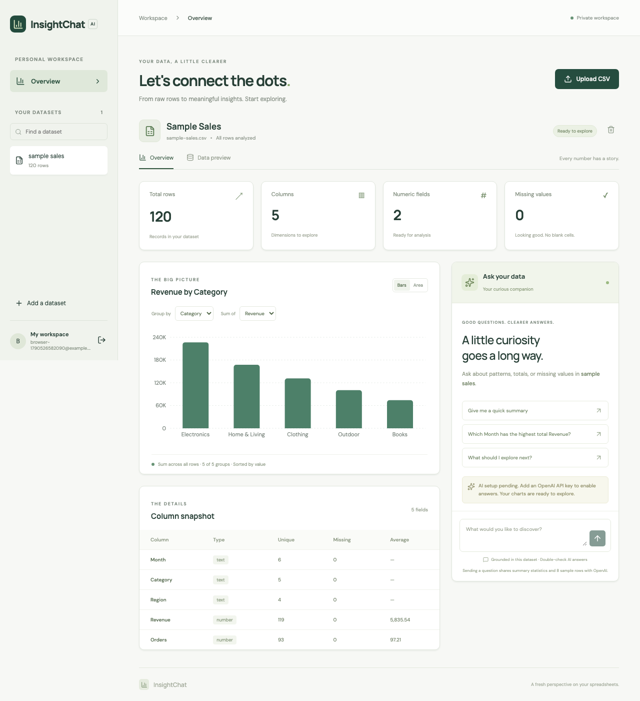
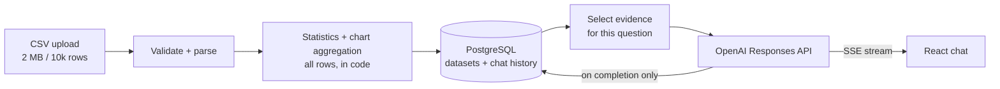

# InsightChat AI

[](https://github.com/SaiSumedh18/insightchat-ai/actions/workflows/ci.yml)

Upload a CSV, get a dashboard, and ask questions about your data in a streaming chat. The goal: **an AI assistant that can't make up numbers.** All arithmetic happens in application code. The model only explains results it is given, and it says so when the data can't answer a question.

**Live demo:** https://sai-insightchat-demo.onrender.com (free hosting, so the first load can take about a minute). CSV upload, statistics, and charts work. AI chat is turned off on the public demo to avoid API costs. A sample sales dataset is built in.



## Engineering highlights

- **Numbers come from code, not the model.** Statistics and grouped totals are computed over every row in TypeScript. The model receives these results as evidence and cannot run SQL, code, or tools.
- **Question-specific context.** For each question, the server picks only the relevant columns and groups (capped at 12,000 characters). This cut evidence size by **80–94%** across three test questions, compared with the original "send everything" approach.
- **Streaming done carefully.** Answers stream over Server-Sent Events. If the user disconnects, the upstream model call is cancelled. A chat turn is saved only after the model signals completion, so failed or aborted answers never leave half a message in history.
- **Prompt-injection hygiene.** CSV content, filenames, column names, and chat history are passed as untrusted data, never placed in system instructions. Output is rendered as plain text.
- **Ownership checks before every read and every model call.** Auth uses HttpOnly SameSite=Strict cookies, origin checks on writes, and per-user rate limits. Each user can run one inference at a time.

## Architecture



## Results

Evidence size per question, before and after question-specific selection (10,000-row synthetic dataset):

| Question                  | Before (tokens) | After (tokens) | Reduction |
| ------------------------- | --------------: | -------------: | --------: |
| Revenue by Category       |           8,170 |            483 |     94.1% |
| What is the total Profit? |           8,170 |            716 |     91.2% |
| Summarize this dataset    |           8,170 |          1,622 |     80.2% |

These are local token estimates for the evidence only, not measured API bills. Method: [engineering notes](docs/ENGINEERING_NOTES.md#measured-evidence-context-reduction).

## Tech stack

| Area        | Tools                                            |
| ----------- | ------------------------------------------------ |
| Frontend    | React, TypeScript, Vite                          |
| Backend     | Node.js, Express, TypeScript, Server-Sent Events |
| Data and AI | PostgreSQL (JSONB), OpenAI Responses API         |
| Testing     | Vitest, Supertest (real PostgreSQL), Playwright  |
| Delivery    | Docker Compose, Nginx, GitHub Actions            |

## Run it locally

Requires Node.js 22.12+ and Docker.

```bash
git clone https://github.com/SaiSumedh18/insightchat-ai.git
cd insightchat-ai
npm ci
npm run setup               # creates .env files with random secrets
docker compose up -d --build
```

Open http://localhost:5177 and pick **explore a sample sales dataset**. To turn on AI answers, add `OPENAI_API_KEY` to `.env` and run `docker compose up -d --force-recreate api`. The key stays on the server.

Full setup, CSV rules, security notes, and troubleshooting: [development guide](docs/DEVELOPMENT.md).

## Tests and CI

- 36 backend tests (CSV parsing edge cases, auth, user isolation, streaming success, failure, and abort paths) run against real PostgreSQL with a mocked model.
- 2 Playwright browser tests cover the full flow (sign up, upload, charts, streamed answer, reload, delete) on desktop and mobile widths.
- CI never needs an API key.

## Known limits and next steps

- Rate limits and the one-inference-per-user lock live in memory, so they assume a single API server. Scaling out would need Redis.
- Answer quality with a live model hasn't been formally evaluated yet. An evaluation set of questions with known answers is the next step.
- Numeric work uses JavaScript floats. That's fine for analytics, not for accounting.

---

Built by **Sai Sumedh Kaveti** · [Portfolio](https://saisumedhkaveti.work/) · [LinkedIn](https://www.linkedin.com/in/saisumedhkaveti/)
