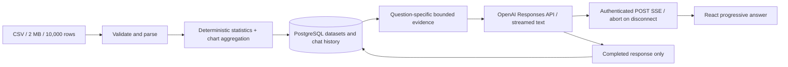

# InsightChat AI — engineering notes

## Grounding and streaming design

All arithmetic stays in application code. The model receives schema, selected all-row statistics, relevant group sums, up to three sample rows, and bounded recent conversation. At most three numeric/two text columns are selected; group results show the top 12 and label omitted evidence. A 12,000-character evidence limit drops excess groups/samples. Sample cells/group labels truncate at 80 characters, with an explicit note. The model must admit when a requested answer is unsupported; it cannot query hidden rows or execute tools/SQL/code. Statistics still use every uploaded row and the existing dashboard/chart API is unchanged.

Prior messages are encoded as untrusted JSON in user content rather than forwarded as privileged assistant roles. CSV text, filenames and column names stay outside system instructions. This reduces exposure but is not a guarantee against every model prompt injection. Model output is plain React text. Raw values in numeric calculations use JavaScript numbers, so high-magnitude totals may have floating-point precision limits.

`POST /api/datasets/:id/messages/stream` emits SSE `delta`, `done`, or `error` events. The original non-stream endpoint still works. SSE passes upstream cancellation and respects output backpressure; clean EOF without a completion event and provider incomplete events fail. User/assistant messages are inserted together only after successful completion. Aborted/failed generation leaves no partial turn. Nginx buffering is disabled. Uploads are limited to 20 per user/minute; both chat endpoints share 10 per user/minute and allow one active inference per user across datasets. Limits and busy state are process-local; scaling to multiple API instances would require a shared store/coordination. Existing authentication, strict-origin checks, HttpOnly cookies and dataset ownership checks remain.

### Measured evidence-context reduction

| Question                  | Before estimated tokens | After estimated tokens | Reduction |
| ------------------------- | ----------------------: | ---------------------: | --------: |
| Revenue by Category       |                   8,170 |                    483 |    94.09% |
| Summarize this dataset    |                   8,170 |                  1,622 |    80.15% |
| What is the total Profit? |                   8,170 |                    716 |    91.24% |

Method: local `js-tiktoken` o200k_base encoding of evidence JSON only, on a synthetic 10,000-row/12-column fixture (six text/six numeric columns, 20 distinct groups per text column). The original evidence function is preserved in `benchmarks/legacy-evidence.ts`; both versions use identical rows and question fixtures. Counts exclude instructions, conversation history, API framing and generated output; they are local estimates, not API billing metadata or cost savings. Reproduce with `node --import tsx benchmarks/context.ts`; raw results: `benchmarks/results/context.json`.

### Re-run 10,000-row HTTP benchmark

| Operation                       | Concurrency | Samples | p50 ms | p95 ms | Requests/sec | Error rate |
| ------------------------------- | ----------: | ------: | -----: | -----: | -----------: | ---------: |
| Upload + deterministic analysis |           1 |      15 |  37.49 |  91.45 |        15.97 |         0% |
| Dataset summary                 |           1 |     100 |   9.10 |  22.21 |        85.42 |         0% |
| Chart aggregation               |           1 |     100 |   9.40 |  32.46 |        69.67 |         0% |

Method: Node 24.11.0, native PostgreSQL 16.3, macOS arm64, an isolated `insightchat_benchmark` database, and one running Express server. Local HTTP fetch requests execute sequentially with no warmup against a 10,000-row/3-column synthetic CSV. Timings include complete response-body decoding. Upload runs 15 samples under the production rate limit, deleting prior uploads between requests; upload throughput includes cleanup, latency does not. Summary/chart run 100 requests against the last persisted upload. Percentiles use nearest-rank. Concurrent local formatting activity may affect these timings. No before/after HTTP latency improvement is claimed, and no model requests were made. Raw results and full method: `benchmarks/results/http.json`. Reproduce with DATABASE_URL pointing to an initialized isolated `_benchmark` database and a temporary JWT_SECRET, then `node --import tsx benchmarks/http.mts`. The script refuses any other database suffix and cleans its own synthetic user.

The 10,000-row cap stays. Current local processing is fast enough that an async CSV queue or raw-file S3 store would add complexity without a measured UX benefit. Neither is implemented or claimed. PostgreSQL remains the dataset store.

### Verification and setup

- Existing setup remains valid; preserve your server/.env. Streaming uses the configured OPENAI_MODEL (default gpt-4.1-mini) and OPENAI_API_KEY via the existing SDK. No credentials were inspected, copied or committed in this upgrade.
- `npm run check`: both TypeScript/frontend builds and 36 backend tests. `npm run format:check`: Prettier. This repository has no separate ESLint configuration; formatting/type checks are the existing static checks.
- Browser verification: set DATABASE_URL to a dedicated `_test` database, set a temporary JWT_SECRET, then `E2E_STUB_AI=1 npm run test:e2e`. Both browser tests run with a test-only deterministic streaming provider; the production entry point never imports it. The original dataset lifecycle E2E remains, plus streamed-answer persistence after reload.
- Docker verification: `docker compose -p insightchat-upgrade-verify -f compose.verify.yml up -d --build --wait` uses PostgreSQL 17 on 5498, API 4391, frontend 8093, no OpenAI key, and independent data. Production Compose still uses its original configuration.
- CI now includes formatting, build/backend tests and both browser E2Es with a deterministic provider. [GitHub Actions passed](https://github.com/SaiSumedh18/insightchat-ai/actions/runs/37157938853) for the implementation commit.

Verified: 36/36 backend tests, 2/2 browser E2Es, builds, formatting, Docker images and isolated Compose startup pass. Provider-event tests mock the OpenAI SDK; route tests use real PostgreSQL and real local HTTP. Live OpenAI generation quality, provider latency/usage, and cloud operation are not verified or claimed. No billable cloud resources or paid model calls were made. The existing frontend bundle-size warning remains.

Streaming follows [official OpenAI documentation](https://developers.openai.com/api/docs/guides/streaming-responses); completion events are required before persistence.
